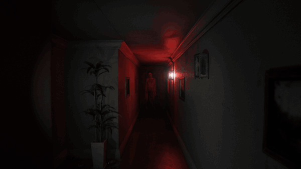

# P.T. for PC

**A native PC port of P.T., the 2014 PS4 teaser by Kojima Productions. Windows, Linux and macOS.**

> [!IMPORTANT]
> **This port is made by one person in their spare time.** If it gave you a good scare, please consider supporting it on [**Patreon**](https://www.patreon.com/loreanxavier). It pays for the testing hardware and keeps the updates coming.

> [!NOTE]
> **Bug reports:** I've closed GitHub Issues because of ongoing spam attacks. Please join the [Discord server](https://discord.gg/3vKwUf2eTb) to report bugs.

This is a native PC port of P.T., the 2014 PS4 teaser by Kojima Productions. It is not an emulator. The game logic was
rebuilt in C++ from the original's behaviour, with Vulkan and DirectX 12 renderers; every level, model, texture, sound,
script and cutscene is read at run time from your own copy of the PS4 game. There is no game data in this repository
and none in the installer.

The port runs on its own engine, Hallway Engine.

I made this in my spare time, with AI tools (see AI Disclosure at the end), because P.T. deserved to keep existing
somewhere other than on consoles that still have it installed. It plays the whole teaser from the first wake-up to
the street, with the voice part included.

## What you need

- Your own copy of P.T. The port is built and tested with the US release, CUSA01127, as a dump folder from your console
  or a fake PKG made from that dump. The folder can have any name: the game recognises it by its files. Other releases,
  such as the European CUSA01114, are accepted the same way, but I have not seen their data myself; the game logs at its
  start what differs from the US data. A store PKG cannot be used: it is encrypted for the console that owns it, and nothing here
  decrypts it.
- Windows 10 or 11 (x64), Linux x86-64 with glibc 2.38 or newer (Ubuntu 24.04, Debian 13, Fedora 39, current Arch
  and SteamOS), or macOS 14 or newer on an Apple silicon or Intel Mac.
- A GPU and driver with Vulkan 1.3; on macOS the port brings MoltenVK, which runs Vulkan on Metal. The optional
  ray-traced shadows, ambient occlusion and reflections need a GPU with Vulkan ray queries (not on macOS). DLSS needs a
  GeForce RTX card. Available upscalers depend on the platform and renderer; see docs/upscaling.md. The settings page greys out what your machine
  cannot run and says why.
- A microphone for one part of the game, as on the PS4. If you have none, `key = J` under `[voice]` in `pt.ini` lets a
  key stand in for the spoken word.

## Installing

Download the installer from the Releases page: `P.T.PC.Port.Setup.exe` on Windows, the Linux setup binary on Linux.
Point it at your dump folder or fake PKG and at a destination folder (the default on Windows is
`%LocalAppData%\Programs\P.T. PC Port`). It copies the three game archives it needs (`chunk1.psarc`,
`texture.qar`, `pathid_list_ps4.bin`) next to the port and makes a shortcut if you want one. The eboot, modules and
system files are not used.

Linux: `chmod +x` the setup and run it from a terminal. The game needs only glibc and the system's Vulkan driver. On a Steam Deck
install from desktop mode and add `pt` as a non-Steam game; it runs on SteamOS as it is.

macOS: download `P.T.PC.Port-macOS-arm64.zip` (M1 and later) or `P.T.PC.Port-macOS-x64.zip` (Intel), unzip `P.T. PC Port.app`,
open it once and allow it under System Settings > Privacy & Security (it is not signed with a Developer ID), then pick your
dump folder when it asks. A fake PKG has to be extracted on Windows or Linux first. Intel Macs need a GPU that MoltenVK can
run the renderer on; the port was written without a Mac at hand and the Intel app has not been run on one yet. More in
docs/macos.md.

Windows and Linux releases include installers and portable ZIPs. To update an existing installation, use the game's update
button or run the new installer over it. Your game archives, settings, saves and mods stay.

On Windows and Linux, settings, saves, logs and cache live in `data/` beside the executable. The game migrates
existing user data without overwriting newer files. On macOS, these stay in `~/Library/Application Support/pt-port/pt/`.
The game checks GitHub Releases for a newer version at startup; `[network] check_updates = 0` disables that check.

Thanks to ahm3texe for the Apple silicon port, totsu0jv for Czech translation, and yewhochen for the Linux library-loading
and startup-focus fixes.

## Playing

Mouse and WASD, right mouse button to zoom, left button, Enter or E to interact, Esc for the pause menu, Alt+Enter for
fullscreen, F10 for the PC settings. Any gamepad works as the PS4 pad; the button prompts follow whatever you used
last (keyboard, PlayStation, Xbox or Switch). Vibration follows the original's patterns. The in-game options
(brightness, subtitles, camera inversion) are the original ones, and as on the PS4 the option screen and the preface
only play on a first start.

## What the port adds

The Original preset keeps the PS4 look. The port also includes the following features.

Display and image
- Windowed, borderless or exclusive fullscreen, with a selectable render resolution and v-sync on or off. Exclusive
  fullscreen lists supported display modes; borderless keeps the desktop window and can render at another selected size.
- Upscalers: AMD FSR 3.1 and FSR 4, NVIDIA DLSS (with a choice of model) and Intel XeSS, in the usual quality steps or a
  custom scale, plus native-resolution anti-aliasing (FSR native AA, DLAA).
- Frame generation: AMD FSR 3 and NVIDIA DLSS Frame Generation, with an optional unlock for RTX 20 and 30 and a multi frame
  generation multiplier where supported. DLSS Frame Generation requires DirectX 12.
- DLSS 5 neural rendering on DirectX 12, installed from inside the game, with separate neural model, quality and strength controls.
- Path traced lighting, NVIDIA Ray Reconstruction, and experimental AMD FSR Ray Regeneration with FSR 4 on supported
  Radeon RX 9000 cards, DirectX 12 and Windows 11. Radeon hardware validation is still pending.
- Graphics presets Low, Medium, Original (PS4), High, Ultra and Custom. The individual controls cover shadow map size,
  ray-traced shadows (sharp like the original or soft), contact shadows, ray-traced ambient occlusion, ray-traced floor
  reflections, anisotropic filtering, film grain, motion blur, depth of field, the original's lens flare ghosts and the curved lens with colour
  fringing. Each one can go back to the PS4 setting on its own.

Extras
- Photo mode (F7): pause, fly the camera, adjust focal length, focus, aperture, exposure and roll, choose an aspect
  crop and color filter, then save at native resolution or 4K (3840 pixels on the long edge) to Pictures/PT Photos.
- Free camera (F6).
- Loop browser: jump to any loop of the house once you have finished the game.
- Museum: the game's subliminal images, radio and voice lines with transcripts, photo pieces, cutscenes, models and
  unused content, as you reach them in play. Pan model exhibits with WASD or the left stick; orbit with arrows or the
  right stick.
- Controller feedback: Original vibration is the default. Enhanced adds supported trigger vibration and, on supported
  wired USB DualSense controllers on Windows, haptics from filtered Lisa cries. DualSense speaker playback remains optional.
  Experimental DualShock 4 speaker playback starts automatically over Bluetooth. Speaker volume is separate from vibration;
  the main game and headphone mix continue unchanged. Physical DS4 speaker output has not been verified.
- Game+: the content a finished game unlocks.
- Speedrun timer with a split at every loop, real time and game time, personal bests, and a LiveSplit server
  connection (Control > Start TCP Server in LiveSplit).
- Third person view (experimental).
- VR through OpenXR (experimental: I have no headset, so it has only run against a simulated runtime). See
  docs/vr.md before trying it.

Languages
- The original's English, French, German, Spanish, Italian, Portuguese and Japanese, plus Turkish, Simplified Chinese,
  Arabic, Russian, Ukrainian, Polish and Czech added by the port: menus, the PC settings and all subtitle lines. Voice audio stays the
  original English, and the word the microphone listens for is always "Jack".

Mods
- A `mods` folder next to the executable can replace game files, textures and sounds, and run Lua scripts that react
  to game events. See docs/modding.md and docs/lua_api.md.

## Building from source

Windows: Visual Studio 2022 Build Tools, LLVM (clang-cl), the Vulkan SDK, CMake 3.28 and Ninja. Then

    tools\build_pt.bat release

gives `build\release\pt.exe`. CMake fetches the dependencies (SDL3, zlib, volk, VMA, glm, Dear ImGui, stb, Lua 5.1,
libogg, libvorbis, whisper.cpp and Google libsbc) and downloads the Whisper and Silero models and the upscaler SDK files, each checked by
SHA-256. Windows release builds require the upscaler SDKs and stop if required downloads fail. `python
tools\package.py` turns the build into the portable folder and zip.

Linux: `cmake -G Ninja -B build/linux -DCMAKE_BUILD_TYPE=RelWithDebInfo && cmake --build build/linux --target pt`.
GCC 13 or clang 17, the Vulkan headers and `glslc`. Linux includes DLSS and FSR 3.1; XeSS and DLSS Frame Generation are Windows-only.
`tools/linux/` has the cross build I use from Windows. More in docs/linux.md.

macOS (Apple silicon or Intel, built for the CPU it runs on): the command line tools, then `brew install cmake ninja shaderc
vulkan-headers vulkan-loader` and `cmake -G Ninja -B build/macos -DCMAKE_BUILD_TYPE=RelWithDebInfo && cmake --build
build/macos --target pt`. `python3 tools/macos/make_app.py` makes the app bundle and its zip. The upscalers and the VR mode
are left out there too, and MoltenVK has no ray queries. More in docs/macos.md.

The unit tests are CMake targets (`pt_tests`, `pt_mods_test` and the others in CMakeLists.txt). `python
tools/walkthrough.py --exe build/release/pt.exe --game <folder>` plays the whole game without a window through the
scripted routes in `tests/walkthrough/` and checks the log; it is how I make sure a change did not break a loop.

The installer is `installer/`: a native C++ setup (`pt_setup`, built when a payload exists) and a small LGPL extraction
helper in C# that reads fake PKGs with LibOrbisPkg. docs/installer.md describes how it decides what it accepts.

Other docs: docs/upscaling.md, docs/vr.md, docs/updates.md, and the file format notes in docs/formats/ that came out of
reverse engineering the game data, with the tools in tools/ that read those formats.

## Support the port

Every release is built, tested on real hardware and checked against the PS4 by hand. Patreon support is what makes that possible: new GPUs and handhelds to test on, the Mac and Steam Deck work, and the time to keep fixing what players report. Thank you to everyone who already helps.

## Thanks

P.T. is the work of Kojima Productions and is owned by Konami. This project is not affiliated with, endorsed by or
connected to either of them. It contains none of their assets and does nothing without your own copy of the game.

The shadPS4 emulator was my reference for how the original behaves on the PS4 and for checking the port's frames
against it. Thanks to its developers.

The port is built on SDL3, Vulkan (volk, VMA), glm, Dear ImGui, stb, Lua 5.1, libogg and libvorbis, whisper.cpp with
OpenAI's Whisper model and the Silero VAD for the voice part, Google libsbc for the DS4 speaker, AMD
FidelityFX, NVIDIA DLSS and Intel XeSS for the upscalers, MinHook in the DLSS 5 companion, the Khronos OpenXR loader for VR, HarfBuzz on Linux and the
Noto fonts for the added languages, and LibOrbisPkg in the installer. Their notices ship in `licenses/` next to the
executable.

## License

The port's own code is under the MIT license (see LICENSE). P.T. and all of its content belong to Konami, and the
third-party pieces listed above keep their own licenses (see NOTICE).

## AI Disclosure

AI coding tools were used in developing and debugging this port. My focus has been on matching the original P.T.:
comparing builds with PS4 references, identifying discrepancies, testing gameplay and prioritizing fixes.

The project uses the original game assets from the player's own PS4 copy. Optional upscalers and neural rendering use
machine-learning models when enabled.
